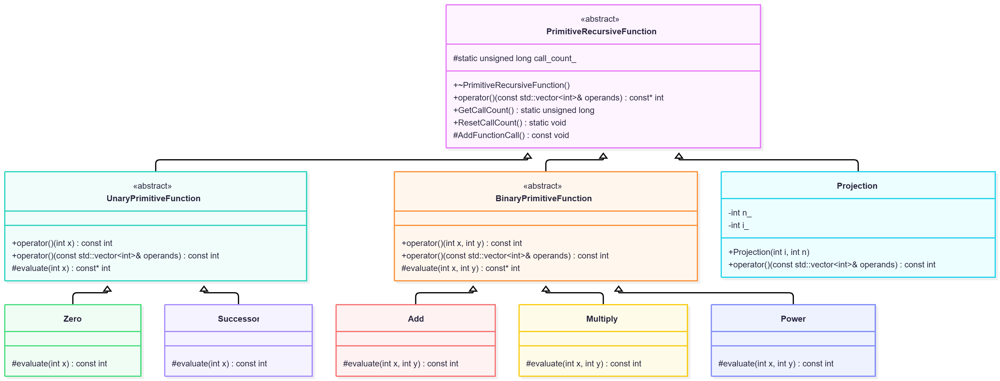

# Práctica 03. Funciones Primitivas Recursivas: Potencia
- **Autor:** Adrián Pérez Poleo
- **Correo:** alu0101635224@ull.edu.es

## Descripción del proyecto
Este proyecto implementa un programa orientado a objetos en C++ que calcula la función potencia evaluada como una **Función Primitiva Recursiva** de números naturales.

### Modelo Implementado
Antes de mostrar el código se muestra cómo se ha desarrollado la función.
Para ello, se han utilizado las siguientes Funciones Primitivas Recursivas:

- **Función Cero:** $Z(x) = 0$
- **Función Sucesor:** $S(x) = x + 1$
- **Función Proyección:** $P_i^n(x_1, \dots, x_n) = x_i$

- **Función Suma:**
  - $suma(x, 0) = P_1^1(x)$
  - $suma(x, S(y)) = S \circ P_3^3(x, y, suma(x, y))$
- **Función Producto:**
  - $producto(x, 0) = Z(x)$
  - $producto(x, S(y)) = suma \circ (P_1^3 \times P_3^3)(x, y, producto(x, y))$
- **Función Potencia:**
  - $potencia(x, 0) = S \circ Z(x)$
  - $potencia(x, S(y)) = producto \circ (P_1^3 \times P_3^3)(x, y, potencia(x, y))$

Al finalizar su ejecución, el programa muestra por pantalla tanto el resultado final de la operación como el número total de llamadas a funciones que se han requerido.

## Estructura del Proyecto
El código sigue la estructura estándar utilizada para desarrollar proyectos con CMake.

```bash
primitive-recursive-functions/
├── CMakeLists.txt
├── README.md
├── include
│   ├── add.h
│   ├── basic_functions.h
│   ├── multiply.h
│   ├── power.h
│   ├── primitive_recursive_function.h
│   └── program_options.h
└── src
    ├── main.cc
    ├── primitive_recursive_function.cc
    └── program_options.cc

```

## Compilación y Ejecución

Para poder compilar el proyecto es necesario disponer de:

* Compilador C++ con soporte para **C++20**
* **CMake 3.20** o superior

### Pasos a seguir para la compilación

```bash
# Crear un directorio para compilar
mkdir build && cd build

# Generar los archivos para construir el proyecto
cmake ..

# Compilar el proyecto
make

```

De esta manera se generará el ejecutable `power` dentro del directorio `build/`.

## Opciones de Línea de Comandos

El programa debe recibir dos parámetros en la línea de comandos correspondientes a la base y al exponente:

* `-x <n>`: Valor natural que será la base de la potencia.
* `-y <n>`: Valor natural que será el exponente de la potencia.

### Ejemplo de Ejecución

```bash
./power -x 2 -y 10

```

**Salida:**

```text
Resultado: 1024
Número de llamadas a funciones: 699083

```

## Arquitectura del Software

El diseño del programa sigue el paradigma de Programación Orientada a Objetos.



### Descripción de los principales elementos:

* **`PrimitiveRecursiveFunction`**: Clase abstracta que define la interfaz y gestiona el contador de llamadas (`call_count_`).
* **`UnaryPrimitiveFunction` y `BinaryPrimitiveFunction**`: Clases abstractas intermedias que validan la aridad.
* **`Projection`**: Clase que implementa la función proyección, validando su aridad.
* **`Zero` y `Successor**`: Clases que implementan las funciones primitivas básicas.
* **`Add`, `Multiply` y `Power**`: Clases que implementan la suma, el producto y la potencia de forma recursiva.
* **`ProgramOptions`**: Estructura encargada de procesar y verificar que los argumentos de entrada son válidos.