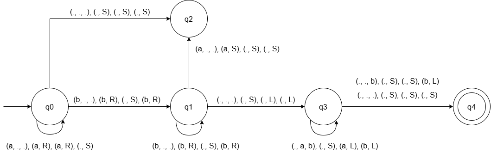

# Práctica 01. Simulación de Máquina de Turing
* **Autor:** Adrián Pérez Poleo
* **Correo:** alu0101635224@ull.edu.es

## Descripción del proyecto
Este proyecto implementa un simulador orientado a objetos en C++ para una Máquina de Turing Determinista Multicinta.

### Modelo Implementado
Antes de mostrar el código se desarrolla brevemente en qué consiste el modelo de computación que se ha implementado.

Una máquina de Turing determinista multicinta se define formalmente como una 7-tupla:

$$M = (Q, \Sigma, \Gamma, q_0, b, F, \delta)$$

Donde:
* **$Q$**: Conjunto finito y no vacío de estados.
* **$\Sigma$**: Alfabeto de entrada (donde el símbolo blanco $b \notin \Sigma$).
* **$\Gamma$**: Alfabeto de la cinta (donde $\Sigma \subset \Gamma$ y $b \in \Gamma$).
* **$q_0 \in Q$**: Estado inicial.
* **$b \in \Gamma$**: Símbolo blanco que representa las celdas vacías de la cinta.
* **$F \subseteq Q$**: Conjunto de estados finales o de aceptación.
* **$\delta: Q \times \Gamma^k \to Q \times \Gamma^k \times \{L, R, S\}^k$**: Función de transición (donde $k$ es el número de cintas).

**Criterio de Aceptación:** Una cadena $w \in \Sigma^*$ es aceptada por la máquina si, tras procesar la entrada realizando las transiciones correspondientes, la máquina se detiene y su estado actual pertenece al conjunto de estados de aceptación $F$.

## Estructura del Proyecto
El código sigue la estructura estándar utilizada para desarrollar proyectos con CMake.

```bash
turing-machine/
├── CMakeLists.txt
├── README.md
├── examples
│   ├── Ejemplo1_MT.txt
│   ├── Ejemplo2_MT.txt
│   ├── Tarea1.txt
│   ├── Tarea2.txt
├── include
│   ├── alphabet.h
│   ├── multitape.h
│   ├── program_options.h
│   ├── state_manager.h
│   ├── tape.h
│   ├── transition_table.h
│   ├── turing_machine.h
│   ├── turing_machine_configuration_reader.h
│   ├── turing_machine_error.h
│   └── types.h
└── src
    ├── main.cc
    ├── multitape.cc
    ├── program_options.cc
    ├── tape.cc
    ├── transition_table.cc
    ├── turing_machine.cc
    └── turing_machine_configuration_reader.cc
```

## Compilación y Ejecución
Para poder compilar el proyecto es necesario disponer de:
- Compilador C++ con soporte para **C++20**
- **CMake 3.20** o superior

### Pasos a seguir para la compilación
```bash
# Crear un directorio para compilar
mkdir build && cd build

# Generar los archivos para construir el proyecto
cmake ..

# Compilar el proyecto
make
```

De esta manera se generará el ejecutable `turing-machine-simulator` dentro del directorio `build/`.

## Opciones de Línea de Comandos

El programa debe recibir el siguiente parámetro obligatorio en la línea de comandos:
- `-config <fichero>`: Nombre del [fichero](#formato-del-fichero-de-configuración) que contiene la configuración de la máquina de Turing.

### Ejemplo de Ejecución
```bash
./turing-machine-simulator -config ../examples/Ejemplo1_MT.txt
```

## Formato del Fichero de Configuración
El fichero de configuración acepta líneas vacías y comentarios que comienzan por `#`. El formato esperado es el siguiente, respetando el orden estricto de las definiciones:
```bash
# Comentarios
q0 q1 q2                # conjunto de estados Q
0 1                     # alfabeto de entrada Σ
0 1 . a b               # alfabeto de cinta Γ
q0                      # estado inicial
.                       # símbolo blanco
q2                      # conjunto de estados de aceptación F
1                       # número de cintas (k)
q0 0 q1 0 R             # transiciones: estado_actual, [simbolos_leidos], estado_siguiente, [simbolos_escritos, movimientos]
...                     # cada una de las transiciones en una línea distinta
```
*Nota: Para máquinas multicinta, la transición incluye el símbolo a leer, el símbolo a escribir y el movimiento por cada cinta. (Ejemplo: `estado_actual lee_c1 lee_c2 estado_sgte escribe_c1 mueve_c1 escribe_c2 mueve_c2`)*

## Arquitectura del Software
El diseño del programa sigue el paradigma de Programación Orientada a Objetos.

### Descripción de los principales elementos:
- `TuringMachine`: Clase principal que simula el comportamiento del autómata, coordinando las cintas, los estados y las transiciones.
- `Multitape`: Clase que gestiona múltiples instancias de la cinta (`Tape`), permitiendo simulaciones de Máquinas de Turing multicinta.
- `Tape`: Abstracción de una cinta infinita de la máquina. Implementa la lectura, escritura y el movimiento del cabezal (`L`, `R`, `S`).
- `StateManager`: Clase encargada de almacenar y actualizar el estado actual de la máquina, validando si se encuentra en un estado de aceptación.
- `TransitionTable`: Clase que almacena y busca las reglas de transición definidas en la configuración, mapeando un estado y un vector de símbolos leídos a una acción resultante.
- `TuringMachineConfigurationReader`: Clase especializada en analizar sintácticamente (parser) el fichero de configuración, ignorando comentarios y validando sus componentes.
- `Alphabet`: Clase que valida los símbolos permitidos durante la inserción y modificación de la cinta, evitando errores con caracteres no reconocidos.

## Máquinas de Turing realizadas

### Máquina 01


## Máquina 02
